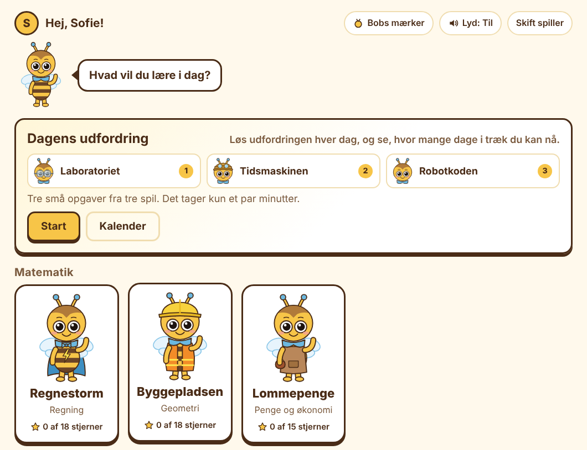
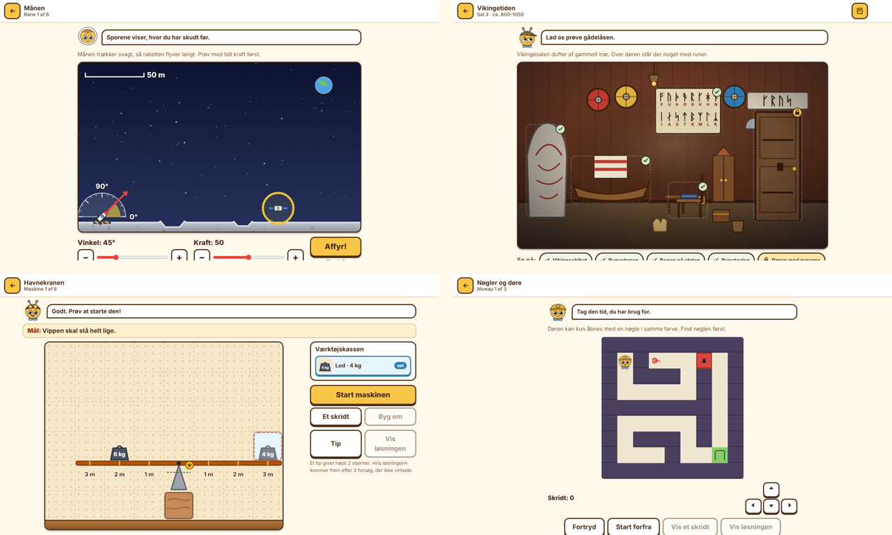

# Lær med Bob 🐝

**Learning games for children aged 8–14, in Danish.** Seventeen games about maths, Danish, English, science, history, logic, coding, music and more, with Bob the bee as a friendly guide. No ads, no login, no tracking, and it works offline.

### ▶ [Play now: zeonos.github.io/learn-with-bob](https://zeonos.github.io/learn-with-bob/)

Works in any modern browser on a computer, tablet or phone. Nothing to install.



> **På dansk:** Lær med Bob er gratis læringsspil til børn fra 8 til 14 år. Spillene følger skolens fag og har to sværhedsgrader: mellemtrin (8–11 år) og udskoling (12–14 år). Der er ingen reklamer, intet login og ingen sporing, og alt gemmes kun i browseren. [Spil med det samme](https://zeonos.github.io/learn-with-bob/).

## What it is

- **17 games across five subjects**, each one a real game first (rockets, mazes, an escape room, chain-reaction machines) with the lesson built into the play.
- **Two difficulty tracks in every game:** *Mellemtrin* (8–11 years) and *Udskoling* (12–14 years). The child picks one, and can switch at any time.
- **Built for practice, not speed.** There are no timers and no speed scores. Hints and step-by-step solutions are always there, and every answer comes with a short explanation of why.
- **Facts are checked.** History, science and geography facts are checked against sources such as Lex and Nationalmuseet, and all Danish text is spell-checked.
- **Private by design.** Everything runs in the browser and progress is saved only on the device. See [Security and privacy](#security-and-privacy).



## How to play

1. **Open the game** at [zeonos.github.io/learn-with-bob](https://zeonos.github.io/learn-with-bob/).
2. **Create a player:** type a name, pick a colour and choose a track (Mellemtrin or Udskoling). Several children can share one device; each gets their own progress (»Skift spiller« switches player).
3. **Pick a game** on the start page. Games are grouped by subject.
4. **Choose a route or level** on the game's map. Each round ends with up to **3 stars**:
   - 3 stars: solved on your own.
   - 2 stars: solved after using a tip.
   - 1 star: the solution was shown (after three tries, »Vis løsningen« appears and explains it step by step).
   You can always play a round again to improve your stars.
5. **Dagens udfordring** (today's challenge) on the start page gives three small tasks from three games every day. A calendar shows the days you've played, and one missed day a week counts as a rest day.
6. **Bobs mærker** (Bob's badges) are earned for practising, exploring and coming back. Every badge unlocks something for Bob to wear: bow ties, wings, hats and more.
7. Several games have a **free-play mode** where you build your own puzzle, maze, rocket course, machine or piece of music. Many of them can be shared with a friend as a short code.

Sound can be turned on and off on the start page, and »Læs højt« reads tasks aloud with the device's own voices for children who need it.

### Install it like an app

On a phone or tablet, open the site and add it to the home screen: in Safari, tap the Share button and **»Føj til hjemmeskærm«**; in Chrome, open the ⋮ menu and choose **»Føj til startskærm«** or **»Installer app«**. It then opens full-screen like an app and works **without internet**.

### For grown-ups

The link **»For voksne«** at the bottom of the start page opens the parent page (behind a small multiplication question to keep children out). There you can:

- see each child's time played, stars per game, badges and daily-challenge streak;
- change a child's track, sound and automatic read-aloud, or reset or delete a player;
- **move progress to another device:** »Gem fremskridt« gives a code or a file, and »Hent fremskridt« on the other device reads it back in.

## The games

| Subject | Game | What the child does |
| --- | --- | --- |
| Matematik | **Regnestorm** | Mental arithmetic and word problems, with tips that show how to think. |
| | **Byggepladsen** | Geometry on a building site: shapes, perimeter, area, volume and the 11 cube nets. |
| | **Lommepenge** | Money: coins and notes, change, unit prices, percentages, moms, interest and loans. |
| Sprog | **Ordjægeren** | Danish: spelling, word classes, commas, sentences and expressions. |
| | **Ordbroen** | English: words, grammar, irregular verbs, false friends, idioms and reading. |
| Natur og samfund | **Laboratoriet** | Science experiments with simulations you can change, plus a logbook of what you found. |
| | **Verdensrejsen** | Geography: Denmark, the Nordic countries, Europe and the world, with maps and capitals. |
| | **Tidsmaskinen** | History: periods, events from the Danish history canon, and real sources. |
| | **Raketbanen** | Physics in space: aim a rocket with angle and power on the Earth, the Moon, Mars, Jupiter and beyond. |
| Logik og hjernevrid | **Tankespind** | Thinking puzzles: patterns, number rows, analogies, folding and mirror images. |
| | **Gådehuset** | Sudoku, picture puzzles, logic grids, river crossings, the Tower of Hanoi, and truth-tellers and liars. |
| | **Labyrinten** | Mazes with keys and doors, one-way squares, ice, crates to push and light beams with mirrors. |
| | **Robotkoden** | Programming: guide a robot with commands and loops through 40 levels. |
| | **Mysteriet på museet** | An escape room: six rooms with puzzles about time, runes, scales and an English letter, plus a thief to catch. |
| Teknologi og kreativitet | **Netdetektiven** | Digital literacy: fake messages, passwords, sharing, sources, images and data. |
| | **Taktslaget** | Music: notes, rhythm, chords and instruments, and composing your own music in »Komponisten«. |
| | **Opfinderværkstedet** | Build chain-reaction machines with ramps, levers, gears and pulleys. |

**Coming next:** Talforsvaret, Bigården, Bogstavkampen, Energiøen, Rygsækrejsen, Spilmageren, Bob i Berlin and Tegneserieværkstedet, for 25 games in total.

## Run it yourself

It's a plain static website, so there's nothing to build.

- **On your own computer:** download or clone the repository and double-click `index.html`.
- **On GitHub Pages:** fork the repository and turn on *Settings → Pages → Deploy from a branch → `main` / root*. All paths are relative, so it works from a sub-path like `/learn-with-bob/`.
- **On any web server:** upload the folder to a static host (the `tools/` and `docs/` folders aren't needed). Use **HTTPS**, which is needed for the offline app mode.
- **After changing files:** raise `VERSION` at the top of `sw.js` (e.g. `bobspil-v22`) so devices that have the game installed pick up the new version.

## Security and privacy

- Everything runs in the browser. There is no server code, no login, no cookies, no tracking and no requests to other sites. Progress is kept in the browser's local storage on each device.
- Give the games their own (sub)domain if you host them yourself, because local storage is shared by everything on the same domain.
- Progress codes (»Gem fremskridt«) contain the child's first name and progress in plain text (base64, not encryption). Imported codes are cleaned, so a code from someone else cannot run code.
- The parent page's multiplication question only keeps children out; it is not a password.
- Read-aloud uses the device's own voices when possible. Some browsers only have online voices, and then the read-aloud text goes to the browser maker's speech service.
- Recommended response headers if you host it yourself (the games work with all of them; GitHub Pages doesn't let you set them):

```
Content-Security-Policy: default-src 'self'; script-src 'self'; style-src 'self' 'unsafe-inline'; img-src 'self' data: blob:; media-src 'self' blob:; connect-src 'self'; object-src 'none'; base-uri 'self'; form-action 'self'; frame-ancestors 'none'
X-Content-Type-Options: nosniff
Referrer-Policy: no-referrer
Permissions-Policy: camera=(), microphone=(), geolocation=()
```

Apache (`.htaccess` in the folder, needs mod_headers): `Header set Content-Security-Policy "…"` and so on for each line, plus `Options -Indexes`. nginx: `add_header Content-Security-Policy "…" always;` for each line, and `autoindex off;`.

## For developers

Plain HTML, CSS and vanilla JavaScript (ES5 style, classic scripts): no build step, no libraries, no network calls. Everything is drawn as inline SVG and sounds are made with Web Audio. All text a child sees is Danish and lives in each game's `strings-da.js`.

### Languages

The games are Danish, and an English (US) version is on its way (Phase 6). `shared/i18n.js` picks the language when the page opens: a `?lang=en` link first, then the last choice on the device, then the browser's language (any Danish in the browser's list means Danish). Each player keeps their own language, and choosing a player opens the page in that player's language.

- Every game's texts are in `strings-da.js`. A `strings-en.js` next to it calls `I18N.add('en', '<prefix>', { … })` with the translated keys, which are laid over the Danish ones.
- A game lists `langs: ['da', 'en']` in `shared/games.js` when its English is complete. A file whose content differs by country can be given as `{ da: 'x.js', en: 'x-en.js' }`.
- `Core.fmt` writes numbers, money and dates the right way for the language (`3,5` / `3.5`, `12,50 kr.` / `$12.50`) and reads typed numbers in either style. Read-aloud uses an American voice in English.
- A language is offered in the picker only when it is marked `ready` in `shared/i18n.js`. Until then, `?lang=en` shows a preview with a note at the top.

### Folders

| Folder | Contents |
| --- | --- |
| `shared/` | Start page (hub, grouped by subject), profiles, parent page, sound, read-aloud, styles, Bob the mascot and his unlockable looks (`mascot/bob.js`). `games.js` lists each game's files (games load when opened). `daily.js` is Dagens udfordring, `badges.js` is Bobs mærker (all 25 planned games have their place and rewards; only games listed in `games.js` show badges); their Danish texts are in `strings-da.js` |
| `regnestorm/` | Maths. Danish texts in `strings-da.js`, problem generator in `problems.js` |
| `byggepladsen/` | Geometry. All maths, the 11 cube nets and the task generators in `geometry.js`, buttons and messages in `strings-da.js` |
| `lommepenge/` | Money. Coins, notes, prices, products, shops, the moms rate and the task generators in `money.js` (update prices here), buttons and messages in `strings-da.js` |
| `ordjaegeren/` | Danish. Words, sentences and rules in `words.js`, buttons and messages in `strings-da.js` |
| `ordbroen/` | English. Words, sentences, grammar, verbs, false friends, idioms and reading texts in `words.js` (British spelling, US accepted), buttons and messages in `strings-da.js` |
| `laboratoriet/` | Science. Experiments, questions and explanations in `content.js`, the simulations in `sim.js`, drawings in `scenes.js`, buttons and messages in `strings-da.js` |
| `verdensrejsen/` | Geography. Place names, capitals and clues in `places.js`, buttons and messages in `strings-da.js`, map data in `maps.js` (generated – do not edit) |
| `tidsmaskinen/` | History. Periods, events (incl. the history canon), things and sources in `events.js`, buttons and messages in `strings-da.js` |
| `raketbanen/` | Physics in space: aim a rocket with angle and power to hit the space station. The predictable physics (gravity, wind, planets that pull) in `physics.js`, the 36 hand-made levels in six worlds with their explanations, facts and stored solutions in `levels.js`, buttons, hints and the Rumlogbog fact cards in `strings-da.js` |
| `tankespind/` | Thinking puzzles in the style of IQ tests (never an IQ number). The puzzle generators, figures, word groups and word analogies in `puzzles.js`, buttons, hints and explanations in `strings-da.js`. Each floor has levels 1–5 that follow the child |
| `gaadehuset/` | Logic puzzles: sudoku (`sudoku.js`), picture puzzles (`nonogram.js`, the 60 pictures in `pictures.js`), logic grids (`logic.js`), river crossings with their stories and explained solutions (`river.js`), Tower of Hanoi (`hanoi.js`) and truth-tellers and liars (`truth.js`). `kinds.js` draws each kind, buttons and explanations in `strings-da.js`. Every puzzle can be solved without guessing |
| `labyrinten/` | Mazes: find the way, keys and doors, one-way squares, shortest road (with mud), ice, crates to push and light with mirrors. All generators and the breadth-first solver in `mazes.js` (it proves every maze can be finished and gives tips and the explained solution), buttons and explanations in `strings-da.js` |
| `robotkoden/` | Coding. Danish texts in `strings-da.js`, the 40 levels with titles and tips in `levels.js` |
| `museet/` | Mysteriet på museet, an escape-room adventure in six rooms (one era each): clock and code, timeline, runes, the merchant's scale, an English letter and the final deduction. The story, suspects, clues and the 12 collection cards with their sources in `story.js`, the seeded puzzle generators and drawings (clock, the 16 runes, scale) in `puzzles.js`, buttons and puzzle texts in `strings-da.js`. All people and the museum are invented; the true story of Guldhornene is told at the end |
| `netdetektiven/` | Digital literacy. Messages, passwords, sharing, scenarios, sources, images and data questions in `cases.js` (all names and brands invented), buttons and messages in `strings-da.js` |
| `taktslaget/` | Music. Note names (Danish: h, not b), rhythms, chords, instruments and the task generators in `music.js`, buttons and messages in `strings-da.js` |
| `opfinder/` | Opfinderværkstedet: chain-reaction machines with ramps, levers, gears and pulleys on a grid. The parts in `parts.js`, the step-by-step rules in `physics.js` (same machine, same run; a ball only enters a ramp from above), the 36 hand-made machines in six worlds in `machines.js`, buttons, explanations and the Opfinderbogen cards with sources in `strings-da.js` |
| `tools/` | Tests, checks and proof sheets (not needed on the server) |
| `docs/` | Screenshots for this README |

### Checks (in `tools/`, need Node.js)

| Command | What it does |
| --- | --- |
| `node tools/test-problems.js` | Generates 90,000 problems and checks every answer independently |
| `node tools/spellcheck.js` | Spell-checks all Danish text with hunspell `da_DK` |
| `node tools/test-ordjaegeren.js` | Checks the Danish word bank with hunspell (needs `hunspell` and `hunspell-da`) |
| `node tools/test-robotkoden.js` | Proves all 40 Robotkoden levels can be solved for 3 stars |
| `node tools/test-laboratoriet.js` | Checks Laboratoriet's simulations against hand-calculated physics, every generated experiment (300 rounds per route) and the Danish text |
| `node tools/test-verdensrejsen.js` | Checks Verdensrejsen's places, capitals, map data and Danish names |
| `node tools/test-ordbroen.js` | Checks Ordbroen's English with hunspell `en_GB`/`en_US` and the Danish with `da_DK`, plus verb forms, gaps and sentences (needs `hunspell-en-gb` and `hunspell-en-us`) |
| `node tools/test-tidsmaskinen.js` | Checks Tidsmaskinen's periods, events, sources and every generated task |
| `node tools/test-netdetektiven.js` | Checks Netdetektiven's cases, that no real brands appear, that sensitive topics are udskoling only, and every generated round |
| `node tools/test-byggepladsen.js` | Proves there are exactly 11 cube nets and re-computes every generated geometry task |
| `node tools/test-lommepenge.js` | Re-computes every sum, change, unit price, percentage, moms, interest and ÅOP; minimal change against brute force; no 1000-kr note |
| `node tools/test-taktslaget.js` | Checks note names and staff positions, that every bar adds up, chords, intervals, scales, rhythm timing and share codes |
| `node tools/test-tankespind.js` | Makes thousands of puzzles per floor and level and re-checks each one its own way: exactly one right answer, wrong figures differ in one thing, number rows and codes re-computed, folds unfolded, mirror images never turn into place, Danish spelling |
| `node tools/test-labyrinten.js` | Solves every kind of maze again with its own searches: fewest moves, doors that need keys, arrows that force a detour, one cheapest road, one reachable exit, codes from the sandbox |
| `node tools/test-gaadehuset.js` | Solves every puzzle again with independent solvers: exactly one solution, every explained step follows from what is known, fewest trips and moves, codes from the sandbox cannot carry anything harmful |
| `node tools/test-raketbanen.js` | Flies every level again with its own physics: the stored solution hits, near misses do not, the same shot always gives the same path, how big the window of hits is per level, sandbox codes |
| `node tools/test-museet.js` | Makes every room thousands of times per band and re-computes each answer its own way (time, timeline order, runes with its own rune table, the scale, the English letter's times, the deduction): exactly one right answer; the story's clues clear exactly the innocent suspects; Danish spelling |
| `node tools/test-opfinder.js` | Runs every machine again with an independently written set of rules, tries every placement of the toolbox parts (both rule sets must agree), counts the solutions, recomputes gear ratios, lever moments and pulley forces, share codes |
| `node tools/check-pictures.js [preview.png]` | Checks that every picture can be solved line by line, and draws them all into one PNG |
| `node tools/test-i18n.js` | Choosing the language, merging texts, number, money and date formats in both languages, every `strings-en.js` against its Danish file (same keys and {placeholders}, no Danish left, US spelling with hunspell `en_US`), and that the files are loaded and cached for offline play |
| `node tools/test-badges-daily.js` | Every badge is reachable, only built games show badges, the streak rules over a simulated year (one rest day a week), the same tasks for the same day |
| `node tools/build-verdensrejsen.js` | Rebuilds `verdensrejsen/maps.js` from Natural Earth (needs `mapshaper` and the Natural Earth files) |
| `node tools/korrektur.js` | Writes the proof sheets `tools/korrektur-*.html` (one per game, plus `korrektur-maerker.html` for badges and the daily challenge) |
| `node tools/looks-gallery.js` | Draws all of Bob's unlockable looks into one PNG for a visual check |
| `node tools/e2e.js` / `e2e-robotkoden.js` / `e2e-ordjaegeren.js` / `e2e-verdensrejsen.js` / `e2e-laboratoriet.js` / `e2e-fase2.js` / `e2e-byggepladsen.js` / `e2e-lommepenge.js` / `e2e-taktslaget.js` / `e2e-tankespind.js` / `e2e-gaadehuset.js` / `e2e-labyrinten.js` / `e2e-raketbanen.js` / `e2e-museet.js` / `e2e-opfinder.js` / `e2e-i18n.js` (switching language, players with their own language, the preview) / `e2e-hub.js` (hub, daily challenge, badges, every game's daily task, and that every title fits its card) | Play the games in a headless browser on desktop, phone and tablet sizes (needs Playwright) |

### Adding a game

Add the game's files to `shared/games.js` and `sw.js`, and its title to `games` in `shared/strings-da.js` (a long title can have a `titleBreak` with a soft hyphen for the start page). The game calls `Core.registerGame({ id, title, mount, unmount, summary, parentReport, progress, quickTask, collection? })`:

- `progress(d)` → `{ plays, bands: { M: [stars per route], U: [...] } }` (used for badges)
- `quickTask(band, d)` → one small task for Dagens udfordring: `{ q, options, answer, hint, explain }` or `{ q, input: 'number', answer, unit }` (Math.random is seeded when it is called; `answer` is always a string)
- at the end of a round: `var node = Core.roundDone(id, routeId, starsBefore or null on the first play, starsAfter)` and put `node` in the result dialog (it shows new badges)
- sandboxes call `Core.visit(id + ':sandbox')`

## Credits

Maps in Verdensrejsen: [Natural Earth](https://www.naturalearthdata.com/) (public domain). Positions of Danish towns: [GeoNames](https://www.geonames.org/) (CC BY 4.0). Danish country and capital names follow Lex (lex.dk).

History facts in Tidsmaskinen are checked against Lex (lex.dk) and follow the Danish history canon (Fælles Mål, revised 2023). Facts in Raketbanen, Mysteriet på museet and Opfinderværkstedet are listed with their sources in each game's proof sheet (`tools/korrektur-*.html`). All companies, apps and web addresses in Netdetektiven are invented.

Lommepenge uses Danish coins (50 øre, 1, 2, 5, 10 and 20 kr; Lex) and the valid notes 50, 100, 200 and 500 kr (Danmarks Nationalbank: the 1000-kr note is no longer valid). Moms is 25 %; the planned lower moms on food (from 2028) is not law yet, so moms tasks use other goods. All shops and products are invented.

## License

[MIT](LICENSE) © 2026 zeonos
